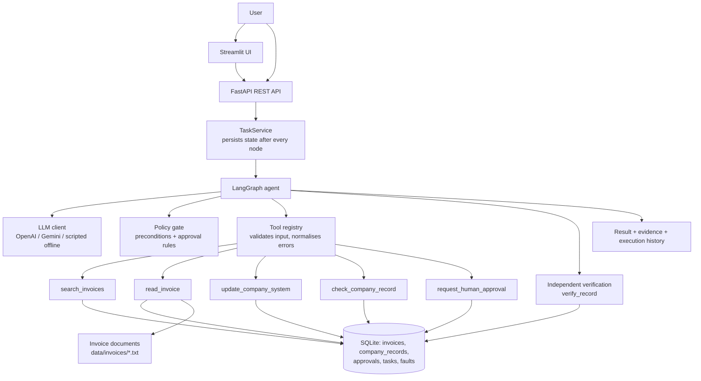
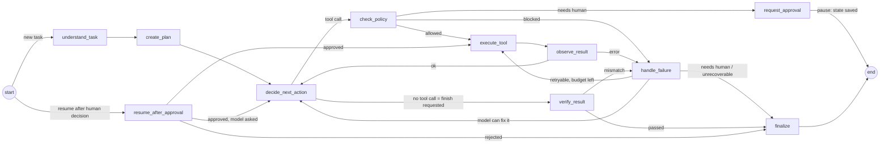

# CentrAlign AI - Autonomous Invoice Processing Worker

An autonomous AI worker that takes a plain-English business task such as

> "Find the latest invoice from Acme Corp, extract the amount and due date, enter it into our internal company system, verify it was entered correctly, and tell me once it is done."

and actually does it: it searches, reads, writes to a (simulated) internal system, **independently verifies** the result, retries or adapts when something fails, asks a human when it should not decide alone, and returns evidence.

Built for the CentrAlign AI Engineering Hiring Assessment (AI Engineering Intern / Founding Engineer).

---

## 1. Problem

Office work is often "find a document, read a number, type it into another system, check it". A person hops between tools and checks their own work. A chatbot can *describe* those steps, but nobody gets the work done. An AI worker has to **do** the steps, notice when something goes wrong, and prove the outcome.

## 2. Solution

A LangGraph agent that works inside a controlled local company environment:

- understands the goal and writes a plan,
- lets an LLM choose which tool to call next, based on what it has observed so far (the tool order is **not** hard-coded in the graph),
- executes real tool calls against SQLite and real invoice files,
- enforces safety rules outside the LLM (argument checks, approval policy, bounded retries),
- verifies the final record with a **separate** check before it is allowed to say "completed",
- returns a summary, evidence and a full structured execution history through a REST API and a Streamlit UI.

## 3. Architecture



### Graph (what actually runs)



## 4. Agent Execution Loop

`Goal -> Understand -> Plan -> Execute -> Observe -> Adapt -> Verify -> Complete`

| Stage | Node(s) | What happens |
|---|---|---|
| Goal / Understand | `understand_task` | The LLM turns the text into a structured `InterpretedGoal` (company, invoice id, "latest" vs "specific"). Unclear or non-invoice tasks stop with `NEEDS_CLARIFICATION`. |
| Plan | `create_plan` | The LLM writes an ordered plan. It is **advisory**: used for the UI checklist and as context. The agent re-decides after every observation. |
| Execute | `decide_next_action`, `check_policy`, `execute_tool` | The LLM picks one tool call from its native tool-calling schema. The policy gate checks it. The registry runs it. |
| Observe | `observe_result` | The result is added to the conversation and to `discovered_information`. Success ticks off the plan. Failure goes to `handle_failure`. |
| Adapt | `handle_failure` | Retry transient errors (bounded), hand fixable errors back to the LLM, ask a human, or stop gracefully. |
| Verify | `verify_result` | When the LLM says it is done, the platform re-reads the company record and compares four fields against the invoice. |
| Complete | `finalize` | Status is `COMPLETED` only if verification passed. Builds summary + evidence. |

## 5. Tech Stack

| Technology | Why |
|---|---|
| Python 3.12+ | Required by the brief; the tests were run on 3.13. |
| LangGraph | Explicit state machine with conditional edges; the loop, retries and pauses are visible in code rather than hidden inside an agent framework. |
| FastAPI | Typed, auto-documented REST API (`/docs`). |
| Pydantic | Tool-argument validation, API schemas, config. Unknown arguments are rejected (`extra="forbid"`). |
| SQLite (`sqlite3`) | Zero-setup, real SQL, inspectable file. Stores the simulated company system, approvals and serialised task state. |
| OpenAI-compatible tool calling | One client covers OpenAI and Gemini (via Google's OpenAI-compatible endpoint). |
| Streamlit | Fast, simple UI for the demo. |
| pytest | 101 tests against a real seeded SQLite database. |

## 6. Project Structure

```
app/
  main.py                 FastAPI app factory
  config.py               Env-based settings (secrets are SecretStr)
  logging_config.py       Logging + API-key redaction
  api/                    routes_tasks.py, routes_health.py
  agent/
    graph.py              LangGraph wiring (nodes + conditional edges)
    nodes.py              All node logic: decide, policy, execute, observe, retry, verify, finalize
    state.py              Typed, JSON-serialisable AgentState + structured event helper
    planner.py            Parse/validate LLM plan, update plan status
    prompts.py            System prompts (task text is always treated as data)
  tools/                  invoice_tools.py, company_tools.py, approval_tools.py, registry.py, base.py
  database/               database.py (schema), repository.py (queries), seed.py (sample data)
  services/
    llm.py                LLM abstraction: OpenAICompatLLM + ScriptedLLM + get_llm()
    task_service.py       Task lifecycle, persistence, approval resume
    verification.py       Field-by-field comparison (expected vs actual)
    reporting.py          Final summary + evidence
    faults.py             Controlled fault injection for demos/tests
  schemas/task.py         API models
frontend/streamlit_app.py UI
scripts/                  seed_database.py, run_scenarios.py
tests/                    test_tools, test_agent, test_failure_recovery, test_api, test_llm
data/                     SQLite file + generated invoice documents (git-ignored, recreated by seed)
```

## 7. Setup

```bash
git clone <MY_REPO_URL> centralign-ai-worker && cd centralign-ai-worker
python -m venv .venv
source .venv/bin/activate          # Windows: .venv\Scripts\activate
pip install -r requirements.txt
cp .env.example .env               # Windows: copy .env.example .env
python scripts/seed_database.py
```

To use a real model, put a key in `.env` (never commit it):

```
OPENAI_API_KEY=sk-...
OPENAI_MODEL=gpt-4o-mini
# or
GEMINI_API_KEY=...
```

With **no key**, the app runs with a clearly-labelled offline `ScriptedLLM` (see section 19).

## 8. Run Backend

```bash
uvicorn app.main:create_app --factory --port 8000
```

Interactive API docs: http://localhost:8000/docs

## 9. Run Frontend

```bash
streamlit run frontend/streamlit_app.py
```

Open http://localhost:8501 (set `API_URL` if the backend is not on `localhost:8000`).

## 10. Run Tests

```bash
python -m pytest
```

Run the five demo scenarios from the command line (throw-away database):

```bash
python scripts/run_scenarios.py
```

### API

| Method | Path | Purpose |
|---|---|---|
| POST | `/tasks` | Submit `{"task": "...", "simulate_fault": null}`. Returns 202 and runs in the background. Add `?wait=true` to block until it finishes or pauses (returns 200). |
| GET | `/tasks/{task_id}` | Status, plan, current step, result, verification, errors, evidence, approval request. |
| GET | `/tasks/{task_id}/history` | Structured execution events and every tool call with arguments/results. |
| POST | `/tasks/{task_id}/approve` | Approve the pending action (`?wait=true` supported, optional `{"note": ""}`). |
| POST | `/tasks/{task_id}/reject` | Reject it. |
| GET | `/health` | Service health, active model, thresholds. |

Task statuses: `QUEUED`, `RUNNING`, `AWAITING_APPROVAL`, `COMPLETED`, `NEEDS_CLARIFICATION`, `ESCALATED_TO_HUMAN`, `VERIFICATION_FAILED`, `REJECTED_BY_HUMAN`, `FAILED`.

## 11. Example Tasks

| Task | Expected |
|---|---|
| `Find the latest invoice from Acme Corp, record it in the internal system, verify it, and tell me when it is done.` | `COMPLETED` - INV-1003, ₹84,500, due 2026-10-20 |
| `Find the latest Acme invoice and record it.` | `COMPLETED` (prefix match on company) |
| `Record invoice INV-1002 from Acme Corp in the company system` | `COMPLETED` - a specific invoice, not the latest |
| `Find the latest invoice from UnknownCompany and record it.` | `NEEDS_CLARIFICATION` |
| `Find the latest invoice from Globex and record it.` | Pauses: ₹3,10,000 is above the ₹1,00,000 threshold |
| `Find the latest invoice from Contoso and record it.` | Pauses: a different record already exists (duplicate) |
| `Find the latest invoice from TechNova and record it.` | Pauses: two invoices share the latest date (ambiguous) |

Demo failure injection (`simulate_fault` in the API, sidebar in the UI) - **controlled simulations**:
`update_transient` (fails twice then recovers), `update_persistent` (never recovers), `corrupt_record` (write "succeeds" with a wrong amount), `db_transient` (one database error on search).

## 12. Failure Recovery

Every tool returns a `ToolResult` with `success`, `error_code` and `retryable`. Exceptions are caught in the registry and converted, so the graph never crashes on a tool.

| Failure | Detection | Response |
|---|---|---|
| Invalid / hallucinated arguments | Pydantic (`extra="forbid"`) -> `INVALID_ARGUMENTS` | Error goes back to the LLM so it can correct itself (bounded by `MAX_RETRIES` adaptations). |
| Arguments that do not match the invoice just read | Policy gate (`ARGUMENT_MISMATCH`, `PRECONDITION_FAILED`) | Blocked before any write; LLM told to use the values from `read_invoice`. |
| Missing company / invoice | `NOT_FOUND` on search | Graceful stop: `NEEDS_CLARIFICATION` with "did you mean" suggestions. |
| Ambiguous company name | `AMBIGUOUS_COMPANY` | `NEEDS_CLARIFICATION` listing the candidates. |
| Database failure (`sqlite3.Error`) / system unavailable | Retryable error | Retry with exponential backoff up to `MAX_RETRIES` (default 3). |
| Still failing after retries | Retry budget exhausted | `ESCALATED_TO_HUMAN` - stops, says exactly what failed. |
| Unreadable invoice document | `EXTRACTION_FAILED` | `ESCALATED_TO_HUMAN`. |
| Duplicate record | Policy gate + `DUPLICATE_RECORD` from the tool | Ask for approval before overwriting. |
| Write "succeeded" but data is wrong | Independent verification mismatch | Mismatch returned to the LLM to correct (bounded); if still wrong -> `VERIFICATION_FAILED`, never `COMPLETED`. |
| Model loops / never finishes | `MAX_STEPS` (default 30) + LangGraph recursion limit | `FAILED`. |
| LLM provider down | `LLMError` | `FAILED` with the reason. |
| Unexpected crash | `TaskService.run_task` catch-all | `FAILED`, state saved. |

## 13. Human-in-the-loop

Before `update_company_system` runs, the policy gate (code, not the LLM) asks for approval when:

- `high_amount`: amount > `APPROVAL_THRESHOLD`,
- `duplicate_record`: a different record already exists for that invoice (overwrite),
- `ambiguous_invoice`: several invoices share the latest date.

The LLM may also call `request_human_approval` on its own when it cannot proceed safely.

Flow: `request_approval` stores a row in `approvals`, sets `AWAITING_APPROVAL`, and the graph run **ends** with its whole state saved in SQLite (nothing blocks a thread). `POST /tasks/{id}/approve` or `/reject` records the decision and re-enters the graph at `resume_after_approval`: approve -> execute the paused action (overwrite is only allowed for the exact approved action), reject -> `REJECTED_BY_HUMAN` with no changes.

## 14. Verification

`verify_result` is separate from execution. When the LLM stops calling tools, the platform itself re-reads the company record (`verify_record`) and compares **invoice_id, company, amount, due_date** with the values extracted from the invoice document. Amounts are compared to the cent; text is compared case-insensitively. The task is `COMPLETED` only if all four match. The comparison (expected vs actual per field) is stored in the history and returned as evidence. `finalize` also refuses to emit `COMPLETED` without a passing verification, as a second guard.

## 15. Security

- No arbitrary shell, no free filesystem access: the LLM can only call five registered tools.
- Invoice ids and company names are regex-validated; all SQL is parameterised; document paths are resolved inside `data/invoices` (path traversal rejected; tested).
- Tool arguments reject unknown fields. The policy gate refuses writes whose values differ from what `read_invoice` returned (anti-hallucination).
- Task text and invoice contents are untrusted: prompts say so, and `read_invoice` returns only parsed fields, not raw text.
- Keys come from environment variables (`SecretStr`), `.env` is git-ignored, and a logging filter masks anything that looks like a key. Event summaries redact secret-looking fields.
- Bounded retries, bounded steps, 500-char task limit with control characters stripped.
- Fault injection is explicitly armed per task and can be turned off with `ENABLE_FAULT_INJECTION=false`.
- No real credentials and no external systems: everything is a local sandbox.

## 16. Known Limitations

- **The "company system" and invoices are a controlled simulation** (SQLite + text files). No real ERP, email, browser or desktop apps.
- Invoices are parsed from a fixed text template with regexes. Real PDFs/scans would need OCR/LLM extraction.
- **The live LLM path was not run against a real model in this build environment** (no API key was available). `OpenAICompatLLM` is unit-tested against a fake client that returns real SDK-shaped responses (tool calls, JSON mode, errors). Add a key and run `scripts/run_scenarios.py` to see it with a real model. Behaviour differs between models; the safety rails do not.
- Without a key the app uses `ScriptedLLM`, a deterministic rule-based policy. It is **not** an LLM; it exists so tests and demos run offline.
- Escalation (`ESCALATED_TO_HUMAN`, `VERIFICATION_FAILED`) is terminal: a human fixes the cause and submits a new task. Only approval pauses are resumable.
- Single process, SQLite, one currency (INR formatting), no auth, no multi-tenancy, no task queue (background tasks run in the API process).
- Docker files are provided but were not built in this environment.

## 17. Future Improvements

- Real connectors (browser/desktop automation, email inbox for invoices, ERP APIs) behind the same tool interface.
- OCR / vision-LLM extraction with confidence scores feeding the approval policy.
- Durable queue + workers (Celery/RQ/Temporal), Postgres, LangGraph checkpointer for resumable runs.
- Company memory (policies, vendor rules, past approvals) retrieved into the prompt.
- Per-role permissions, authenticated approvers, immutable audit log, multi-tenant isolation.
- Evaluation harness: a suite of scenarios with different models, tracking success rate, retries, unsafe-action rate.
- Resumable escalations ("retry now that the system is back").

## 18. Design Decisions

1. **LLM decides the next tool; code enforces safety.** The graph has no `search -> read -> update` chain. Rails (policy, retries, verification) are code because they must not depend on model behaviour.
2. **Verification is its own node and does not trust the LLM or the write's return value.** A write can succeed and still store wrong data (simulated by `corrupt_record`).
3. **Pause/resume via persisted state, not a blocked thread.** Approvals can take hours; state is JSON in SQLite, saved after every node.
4. **Typed tool boundary.** One registry validates input and normalises every failure into the same `ToolResult`, so retry logic is generic.
5. **Failures are classified.** Retryable -> backoff retries; fixable -> back to the LLM; ambiguous/unsafe -> human; unrecoverable -> stop with a precise reason.
6. **Provider-agnostic LLM interface** (`interpret_task`, `create_plan`, `next_turn`) so OpenAI, Gemini or another model is a config change.
7. **Plain `sqlite3`** instead of an ORM: fewer moving parts and easy to explain.

## 19. Models and External Services

| Item | Use |
|---|---|
| OpenAI API (default model `gpt-4o-mini`, set by `OPENAI_MODEL`) | Optional. Task understanding, planning, tool selection via native function calling. |
| Google Gemini (default `gemini-2.0-flash`) via the OpenAI-compatible endpoint | Optional alternative (`GEMINI_API_KEY`). |
| `ScriptedLLM` (`rule-based-policy-v1`) | **Offline stand-in, not a language model.** Used automatically when no key is configured, and in most tests. The active provider/model is shown in `/health`, the UI sidebar, and every task's evidence. |
| LangGraph, FastAPI, Pydantic, pydantic-settings, Streamlit, openai SDK, python-dotenv, requests, pytest, httpx | Frameworks/libraries. |
| AI coding assistance (Claude) | Used to build this project, as the assessment permits. |

No other external services are contacted. Invoices, records and the "internal system" are local simulations.

### Assumptions

- The task is invoice recording; other tasks get `NEEDS_CLARIFICATION`.
- "Latest" = newest `invoice_date` (ties are flagged as ambiguous).
- Amounts are INR; the approval threshold is configurable.
- The invoice document is the source of truth for verification.
